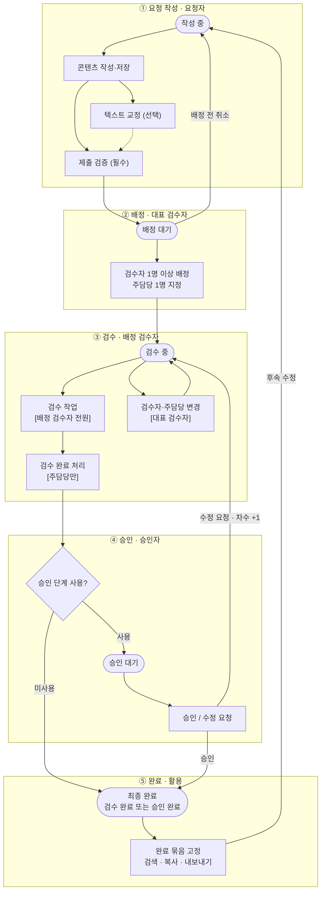
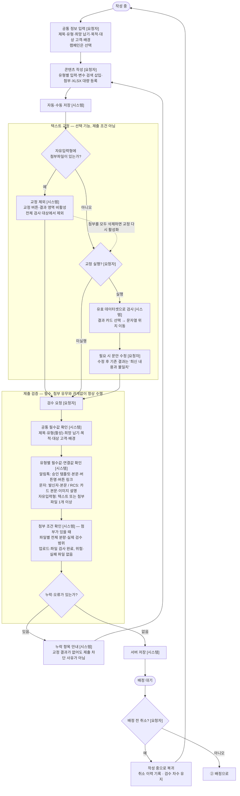
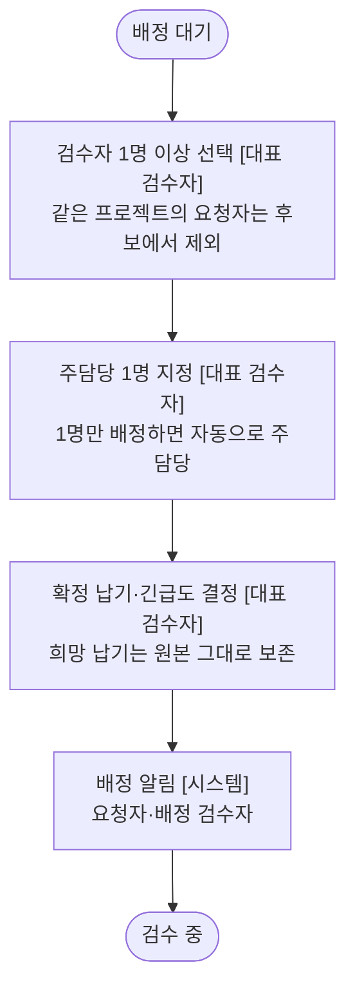
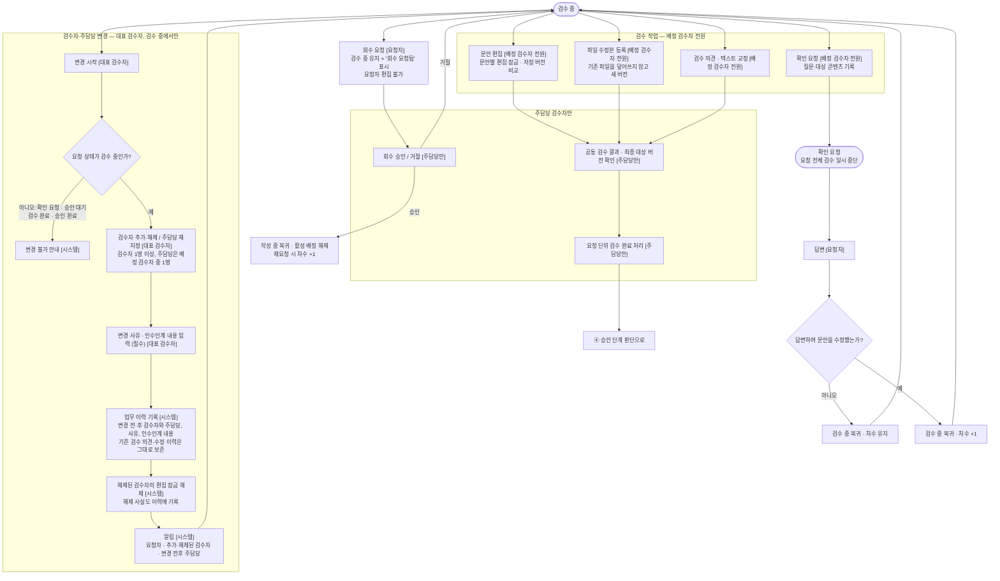
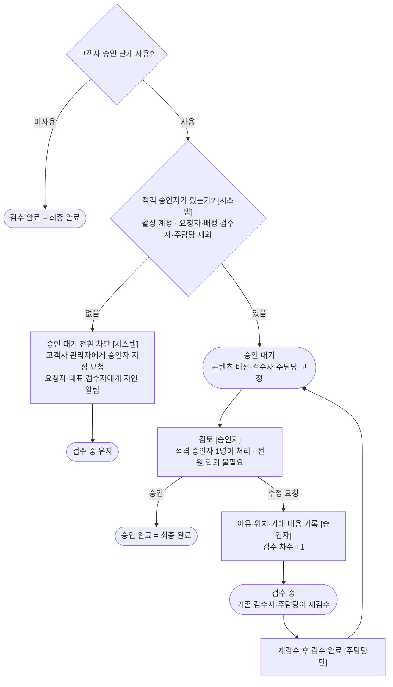
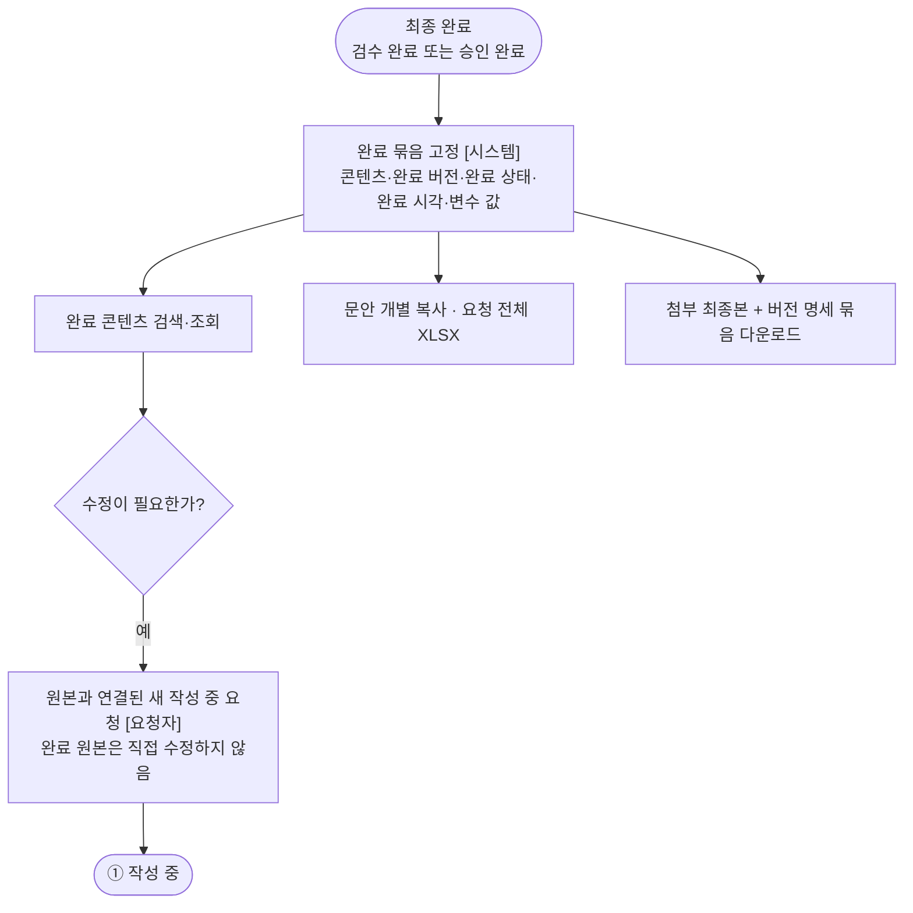

# TX TMS 업무 흐름 플로우차트

- 기준 문서: 제품기획서 v1.7.8, 기능명세·협의회신 v2.0, `plan_v01.md`
- 반영 이력: 2026-10-07 — 클라이언트 의견 ① 요청 작성·요청자, ③ 검수·배정 검수자 반영

## 범례

| 표시 | 의미 |
|---|---|
| 둥근 막대 | 요청 상태 |
| 사각형 | 행동 |
| 마름모 | 판단·조건 |
| `[요청자]` `[대표 검수자]` `[배정 검수자 전원]` `[주담당만]` `[승인자]` `[시스템]` | 해당 행동을 처리하는 담당자 |

상태는 요청 단위다. 요청에 포함된 모든 콘텐츠는 같은 요청 상태를 따른다.

---

## 전체 흐름

---

## ① 요청 작성 · 요청자

텍스트 교정과 제출 검증은 서로 다른 흐름이다.

- **텍스트 교정**은 선택 기능이다. 첨부파일이 있는 자유입력형에서는 교정을 실행할 수 없다.
- **제출 검증**은 모든 요청에 항상 적용한다. 첨부파일이 있는 자유입력형도 공통 필수값과 첨부 조건을 검증한다. 교정만 제외된다.

### 제출 검증 기준 — 자유입력형

| 검증 항목 | 첨부 없음 | 첨부 있음 |
|---|---|---|
| 공통 필수값 (제목·유형·희망 납기·목적·대상 고객·배경) | 검증 | 검증 |
| 텍스트 또는 첨부파일 1개 이상 | 검증 | 검증 |
| 파일별 전체 분량·실제 검수 범위 | 해당 없음 | 검증 |
| 업로드·파일 검사 완료, 위험·실패 파일 없음 | 해당 없음 | 검증 |
| 텍스트 교정 실행 | 선택 (제출 조건 아님) | 사용 불가 (교정 제외) |

---

## ② 배정 · 대표 검수자

---

## ③ 검수 · 배정 검수자

검수 작업과 검수 완료 처리는 담당자가 다르다.

- **검수 작업**은 배정된 검수자 전원이 한다.
- **요청 단위 검수 완료**와 **회수 승인·거절**은 주담당 검수자만 한다.
- **검수자·주담당 변경**은 대표 검수자가 `검수 중` 상태에서만 한다.

### 검수 단계 행동별 담당자

| 행동 | 처리 담당자 | 가능한 요청 상태 |
|---|---|---|
| 문안 편집 · 파일 수정본 등록 · 검수 의견 · 텍스트 교정 | 배정 검수자 전원 | 검수 중 |
| 확인 요청 | 배정 검수자 전원 | 검수 중 |
| 회수 승인 · 거절 | 주담당 검수자만 | 검수 중 (회수 요청됨) |
| 요청 단위 검수 완료 | 주담당 검수자만 | 검수 중 |
| 검수자 · 주담당 변경 | 대표 검수자 | 검수 중 |
| 편집 잠금 강제 해제 | 대표 검수자 · 고객사 관리자 | 검수 중 |

### 검수자 · 주담당 변경 가능 상태

| 요청 상태 | 변경 | 비고 |
|---|---|---|
| 배정 대기 | 최초 배정 | 변경이 아닌 최초 배정 |
| 검수 중 | 가능 | 변경 사유 · 인수인계 필수, 기존 기록 보존 |
| 확인 요청 | 불가 | 답변 후 검수 중으로 돌아오면 변경 가능 |
| 승인 대기 | 불가 | 콘텐츠 버전 · 검수자 · 주담당 고정 |
| 검수 완료 · 승인 완료 | 불가 | 최종 완료 |

---

## ④ 승인 · 승인자

> 활성 승인자는 있으나 해당 요청의 적격 승인자가 없는 경우의 처리는 기획서 6.1절에서 추가 협의(협의 19) 항목이다. 이 플로우차트는 `plan_v01.md` 20절에 따라 같은 차단 절차를 적용한다.

---

## ⑤ 완료 · 활용

모든 조회 · 복사 · 다운로드에서 고객사와 프로젝트 권한을 다시 확인한다.

---

## 검수 차수 규칙

| 구분 | 검수 차수 |
|---|---|
| 확인 요청 / 설명만 포함한 확인 응답 | 유지 |
| 검수자의 문안 · 파일 수정 | 유지 |
| 배정 전 취소 후 재요청 | 유지 |
| 확인 응답 중 요청자의 문안 수정 | +1 |
| 회수 승인 후 재요청 | +1 |
| 승인자의 수정 요청 | +1 |

콘텐츠 버전 증가와 검수 차수 증가는 서로 다른 개념이다.
